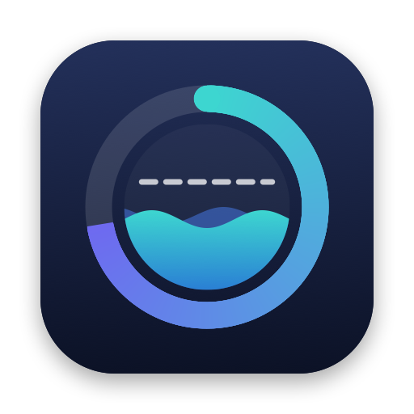

<p align="center"></p>

<h1 align="center">Tidemark</h1>

<p align="center">See your Claude plan usage limits from the macOS menu bar.</p>

<p align="center"><a href="README.md">한국어</a> · <b>English</b></p>

<p align="center">
  <a href="https://github.com/lcalmsky/tidemark/releases/latest"></a>
  
  <a href="LICENSE"></a>
</p>

<p align="center"></p>

<br>

## Quick start

```sh
brew tap lcalmsky/tidemark https://github.com/lcalmsky/tidemark
brew trust lcalmsky/tidemark
brew install lcalmsky/tidemark/tidemark
brew services start lcalmsky/tidemark/tidemark
```

A ring for each limit appears on the right of the menu bar. Hold `⌘` and drag a ring to move it along the menu bar.

<br>

## Features

### Menu bar

For each limit the app draws a ring, a percentage, and the time to reset, in that order from left to right.

| What you see | Meaning |
|---|---|
| Letter inside the ring | The kind of limit. `S` is the session limit and is teal. `W` is the weekly limit across all models and is indigo. A model-scoped weekly limit uses the first letter of the model name; Fable is purple and other models are gray. |
| 16px ring | The usage of that limit. It fills clockwise from 12 o'clock and leaves the remaining share as a faint track. The filled arc uses the same color as the letter inside up to 50%, then gradually shifts to orange by 75% and to red by 100%. |
| Percentage | Rounded usage. It turns orange at 75% and red at 90%. |
| Time next to it | Time until reset, abbreviated as `2d3h`, `4h12m`, or `45m`. |

Until the first response arrives after launch the app draws `C …`, and appends `?` when a fetch fails. Limits are fetched every 5 minutes and the remaining time is redrawn every minute.

### Menu

Clicking a ring in the menu bar opens the following menu.

- Each account gets a header line like `personal · me@example.com (max)`. If the email cannot be read only the name is shown, and the current account is checked. With the Orca source only the first 8 characters of the name are shown.
- Under it, each limit gets an indented line like `세션  42%  · 리셋까지 4h 12m`. A model-scoped weekly limit shows the model name in place of `주간`.
- Next comes the time of that account's last successful fetch as `갱신: 14:05`, plus an `오류: ...` line when the fetch failed.
- With the cca source, clicking an account header runs `cca use <name>` and makes that account the default. With the Orca source the header does nothing when clicked; switch accounts in Orca instead.
- Below the accounts a `전환은 새로 여는 claude 세션부터 적용` line appears. With the Orca source it says `계정 전환은 Orca 에서`. When cca cannot be run or its response cannot be read, an `오류: ...` line appears under it.
- The `계정 출처` submenu picks where the account list and the current account are read from: `cca` or `Orca`. The active one is checked.
- `자동 전환 (95%)` can only be turned on with the cca source; it is disabled with the Orca source.
- `지금 새로고침 ⌘R` fetches again immediately.
- `종료 ⌘Q` quits the app.

<br>

## Account selection

The `계정 출처` submenu picks where the account list and the current account are read from. The default is `cca`.

### cca

The `cca` tool manages the account list and the current account. The app reads the list and the current account from `~/.local/bin/cca ls --json`, and fetches each account's limits with that account's own token. It never falls back to another account's token.

- The `default` account uses the config directory `~/.claude`, the keychain service `Claude Code-credentials`, and the email from `~/.claude.json`.
- Every other account uses `~/.claude-accounts/<name>`, the keychain service `Claude Code-credentials-<first 8 characters of the SHA-256 of the directory path>`, and the email from `<directory>/.claude.json`.
- The menu shows every account with its own limits. Clicking an account runs `cca use <name>` to make it the default; the switch affects only claude sessions started afterwards.
- The rings in the menu bar show the current account (`cca current`). The app runs `cca current` every 60 seconds to notice when the current account changes.
- When cca cannot be run the menu shows `cca 실행 실패` (cca failed to run), and when its response cannot be parsed it shows `cca 응답 파싱 실패` (cca response parse failure); no numbers are shown in either case.
- If an account has no keychain entry, only that account is reported as an error and the app does not look for another account's token.

#### Auto switch

Turning on `자동 전환 (95%)` makes the app check, after every completed fetch, whether the current account's session limit or its weekly limit across all models is at 95% or more.

- When a limit is at 95% or more, the app looks for another account that has no error and is under 95% on both session and weekly, then runs `cca use` for the one with the lowest session usage. On a tie it picks the earlier account in the list.
- After switching it shows a notification like `자동 전환: <from> → <to> (세션 96%)`. The label is `세션` or `주간`, depending on which limit crossed the threshold.
- If no account qualifies it does not switch and shows no notification.
- Model-scoped weekly limits are ignored. A switch affects only claude sessions started afterwards; sessions already running keep using their account.

### Orca

The `Orca` source runs no processes and only reads Orca's profile directory.

- The list shows `default` (`~/.claude`) first, then every directory under `~/Library/Application Support/orca/claude-profiles` that contains `profile.json`, sorted by name. A profile directory's config directory is its `home` subdirectory.
- The keychain service name and the email are read from that config directory using the same rules as cca.
- The current account is the config directory pointed to by the `selected-host` file in the same directory. When the file is missing or empty the current account is `default`. When the file points to a path that is not listed, the app appends that path to the list and uses it as the current account.
- When the file cannot be read the menu shows `계정 선택 파일 읽기 실패` (account selection file read failure); no numbers are shown.
- The rings in the menu bar show the limits of the account `selected-host` points to. The app re-reads that file every 60 seconds to notice when the current account changes.
- Account headers do not switch anything when clicked. Tidemark never writes `selected-host`, so switch accounts in Orca.

<br>

## Requirements

| Requirement | Notes |
|---|---|
| macOS 13 or later | This is an AppKit menu bar app. |
| Xcode Command Line Tools | The app builds with `swift build`. Install them with `xcode-select --install`, or install the Swift toolchain with `brew install swift`. |
| Claude Code sign-in | You need to be signed in with an account that has a Claude subscription to read the limits. |
| `cca` | Only needed for the cca account source. It must be at `~/.local/bin/cca` to read the account list and current account and to switch accounts. |

<br>

## Uninstall

```sh
brew services stop lcalmsky/tidemark/tidemark
brew uninstall lcalmsky/tidemark/tidemark
brew untap lcalmsky/tidemark
```

Running the three lines in order stops the service and removes the app and the tap.

<br>

## Development

```sh
swift build
scripts/bundle.sh           # builds build/Tidemark.app
scripts/test.sh             # runs the unit tests
```

- **App icon** `swift scripts/make-icon.swift` regenerates `assets/AppIcon.icns`, and `scripts/bundle.sh` copies it into the bundle.
- **Release** `scripts/release.sh X.Y.Z -m "<summary of changed features>"` does the version, build, checks, tag, GitHub release, and Homebrew formula update in one go. If it stopped at the step that downloads the tarball, `scripts/release.sh --formula-only X.Y.Z` redoes only the formula update.

<br>

## Things to know

- The app uses `https://api.anthropic.com/api/oauth/usage`. The endpoint is undocumented and may change without notice. If the response format changes the app shows `?` or an `오류` line.
- The token is used only in the authorization header of requests to `api.anthropic.com`, and is never printed to the screen or to a log.

<br>

<p align="center"><a href="LICENSE">MIT</a></p>
