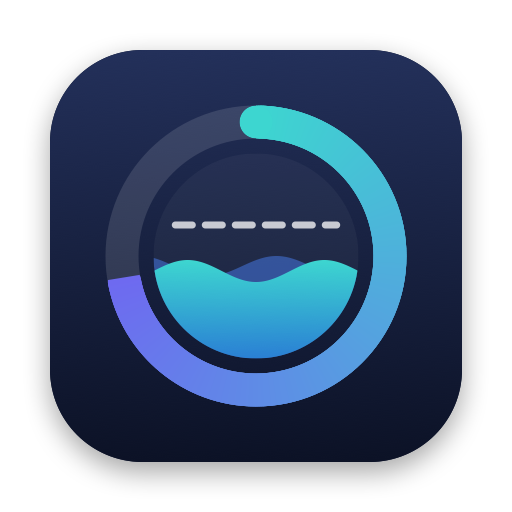

<p align="center"></p>

<h1 align="center">Tidemark</h1>

<p align="center">Claude 플랜의 사용량 한도를 macOS 메뉴 막대에서 봅니다.</p>

<p align="center"><b>한국어</b> · <a href="README.en.md">English</a></p>

<p align="center">
  <a href="https://github.com/lcalmsky/tidemark/releases/latest"></a>
  
  <a href="LICENSE"></a>
</p>

<p align="center"></p>

<br>

## 빠른 시작

```sh
brew tap lcalmsky/tidemark https://github.com/lcalmsky/tidemark
brew trust lcalmsky/tidemark
brew install lcalmsky/tidemark/tidemark
brew services start lcalmsky/tidemark/tidemark
```

메뉴 막대 오른쪽에 한도별 링이 생깁니다. `⌘` 를 누른 채 링을 끌면 메뉴 막대에서 링의 자리를 옮길 수 있습니다.

<br>

## 기능

### 메뉴 막대

한도마다 왼쪽부터 링, 퍼센트, 리셋까지 남은 시간 순서로 그립니다.

| 보이는 것 | 뜻 |
|---|---|
| 링 안의 글자 | 한도 종류를 나타냅니다. `S` 는 세션 한도이고 청록색입니다. `W` 는 모든 모델을 합친 주간 한도이고 남색입니다. 모델별 주간 한도는 모델 이름의 첫 글자를 쓰고, Fable 은 보라색, 그 밖의 모델은 회색입니다 |
| 16px 링 | 그 한도의 사용률을 나타냅니다. 12시 방향에서 시계 방향으로 채우고, 남은 몫은 흐린 트랙으로 남깁니다. 채움은 50% 까지 링 안 글자와 같은 색을 쓰고, 75% 까지 주황색으로, 100% 까지 빨간색으로 조금씩 바뀝니다 |
| 퍼센트 | 사용률을 반올림한 값입니다. 75% 이상이면 주황색, 90% 이상이면 빨간색으로 그립니다 |
| 퍼센트 옆 시간 | 리셋까지 남은 시간입니다. `2d3h`, `4h12m`, `45m` 처럼 줄여 씁니다 |

앱을 켠 뒤 첫 응답이 오기 전에는 `C …` 를 그리고, 조회에 실패하면 뒤에 `?` 를 붙입니다. 한도는 5분마다 다시 조회하고, 남은 시간은 1분마다 다시 그립니다.

### 메뉴

메뉴 막대의 링을 누르면 다음 항목이 나옵니다.

- 계정마다 `personal · me@example.com (max)` 같은 머리줄이 나옵니다. 이메일을 읽지 못하면 이름만 보여 주고, 지금 쓰는 계정에는 체크 표시가 붙습니다. Orca 출처에서는 이름 대신 앞 8자만 보여 줍니다.
- 그 아래에 한도마다 `세션  42%  · 리셋까지 4h 12m` 같은 줄이 들여 쓰여 나옵니다. 모델별 주간 한도는 `주간` 대신 모델 이름을 씁니다.
- 이어서 그 계정을 마지막으로 조회한 시각을 `갱신: 14:05` 로, 조회에 실패했으면 `오류: ...` 줄을 함께 보여 줍니다.
- 계정 출처가 cca 이면 계정 머리줄을 눌러 `cca use <이름>` 으로 그 계정을 기본 계정으로 바꿉니다. Orca 이면 머리줄은 눌러도 아무 일도 하지 않고, 전환은 Orca 에서 합니다.
- 계정 목록 아래에 `전환은 새로 여는 claude 세션부터 적용` 안내가 나옵니다. Orca 출처에서는 `계정 전환은 Orca 에서` 가 나옵니다. cca 를 실행하지 못했거나 응답을 읽지 못하면 그 아래에 `오류: ...` 줄이 나옵니다.
- `계정 출처` 하위 메뉴에서 계정 목록과 현재 계정을 읽을 곳을 `cca` 와 `Orca` 중에서 고릅니다. 지금 쓰는 쪽에 체크 표시가 붙습니다.
- `자동 전환 (95%)` 은 cca 출처에서만 켤 수 있습니다. Orca 출처에서는 비활성으로 보입니다.
- `지금 새로고침 ⌘R` 은 즉시 다시 조회합니다.
- `종료 ⌘Q` 는 앱을 끝냅니다.

<br>

## 계정 선택

계정 목록과 현재 계정을 어디서 읽을지는 `계정 출처` 하위 메뉴에서 고릅니다. 기본값은 `cca` 입니다.

### cca

`cca` 가 계정 목록과 현재 계정을 관리합니다. 앱은 `~/.local/bin/cca ls --json` 으로 계정 목록과 현재 계정을 읽고, 계정마다 그 계정의 토큰으로 한도를 조회합니다. 다른 계정의 토큰으로 넘어가지 않습니다.

- `default` 계정은 설정 디렉터리 `~/.claude` 를 쓰고, 키체인 서비스 이름은 `Claude Code-credentials`, 이메일은 `~/.claude.json` 에서 읽습니다.
- 나머지 계정은 `~/.claude-accounts/<이름>` 을 쓰고, 키체인 서비스 이름은 `Claude Code-credentials-<디렉터리 경로 SHA-256 앞 8자리>`, 이메일은 `<디렉터리>/.claude.json` 에서 읽습니다.
- 메뉴는 모든 계정과 각 계정의 한도를 보여 줍니다. 계정을 누르면 `cca use <이름>` 으로 기본 계정을 바꾸고, 이 변경은 새로 여는 claude 세션부터 적용됩니다.
- 메뉴 막대의 링은 현재 계정(`cca current`)의 한도를 그립니다. 앱은 60초마다 `cca current` 로 현재 계정이 바뀌었는지 확인합니다.
- cca 를 실행하지 못하면 메뉴에 `cca 실행 실패`, 응답을 읽지 못하면 `cca 응답 파싱 실패` 를 보여 주고 수치는 표시하지 않습니다.
- 계정의 키체인 항목이 없으면 그 계정만 오류로 표시하고 다른 계정의 토큰을 찾지 않습니다.

#### 자동 전환

`자동 전환 (95%)` 을 켜면 조회를 마칠 때마다 현재 계정의 세션 한도나 모든 모델 주간 한도가 95% 이상인지 확인합니다.

- 기준을 넘으면 나머지 계정 중 오류가 없고 세션·주간 한도가 모두 95% 미만인 계정을 찾아, 세션 사용률이 가장 낮은 계정으로 `cca use` 를 실행합니다. 세션 사용률이 같으면 목록에서 앞선 계정을 고릅니다.
- 전환하면 `자동 전환: <현재> → <대상> (세션 96%)` 처럼 알림을 띄웁니다. 기준을 넘은 한도에 따라 `세션` 또는 `주간` 을 씁니다.
- 조건에 맞는 계정이 없으면 전환하지 않고 알림도 띄우지 않습니다.
- 모델별 주간 한도는 판단에서 제외합니다. 전환은 새로 여는 claude 세션부터 적용되고, 이미 열려 있는 세션은 쓰던 계정을 그대로 씁니다.

### Orca

`Orca` 출처는 프로세스를 실행하지 않고 Orca 의 프로필 디렉터리만 읽습니다.

- 목록에는 `default`(`~/.claude`)가 먼저 나오고, 이어서 `~/Library/Application Support/orca/claude-profiles` 아래에서 `profile.json` 을 가진 디렉터리가 이름순으로 나옵니다. 프로필 디렉터리의 설정 디렉터리는 그 안의 `home` 입니다.
- 키체인 서비스 이름과 이메일은 cca 와 같은 규칙으로 그 설정 디렉터리에서 읽습니다.
- 현재 계정은 같은 디렉터리의 `selected-host` 파일이 가리키는 설정 디렉터리입니다. 파일이 없거나 비어 있으면 `default` 입니다. 목록에 없는 경로가 들어 있으면 그 경로를 목록에 덧붙여 현재 계정으로 씁니다.
- 파일을 읽지 못하면 메뉴에 `계정 선택 파일 읽기 실패` 를 보여 주고 수치는 표시하지 않습니다.
- 메뉴 막대의 링은 `selected-host` 가 가리키는 계정의 한도를 그립니다. 앱은 60초마다 그 파일을 다시 읽어 현재 계정이 바뀌었는지 확인합니다.
- 계정 머리줄은 눌러도 전환되지 않습니다. Tidemark 는 `selected-host` 를 쓰지 않으므로 전환은 Orca 에서 합니다.

<br>

## 요구 사항

| 조건 | 비고 |
|---|---|
| macOS 13 이상 | AppKit 메뉴 막대 앱입니다 |
| Xcode Command Line Tools | `swift build` 로 빌드합니다. 없으면 `xcode-select --install` 로 설치하거나 `brew install swift` 로 Swift 툴체인을 설치합니다 |
| Claude Code 로그인 | Claude 구독이 있는 계정으로 로그인해 두어야 한도를 읽습니다 |
| `cca` | 계정 출처를 `cca` 로 쓸 때만 필요합니다. `~/.local/bin/cca` 에 있어야 계정 목록과 현재 계정을 읽고 계정을 전환합니다 |

<br>

## 제거

```sh
brew services stop lcalmsky/tidemark/tidemark
brew uninstall lcalmsky/tidemark/tidemark
brew untap lcalmsky/tidemark
```

세 줄을 차례로 실행하면 서비스가 멈추고 앱과 tap 이 제거됩니다.

<br>

## 개발

```sh
swift build
scripts/bundle.sh           # build/Tidemark.app 을 만든다
scripts/test.sh             # 단위 테스트를 돌린다
```

- **앱 아이콘** `swift scripts/make-icon.swift` 가 `assets/AppIcon.icns` 를 다시 만들고, `scripts/bundle.sh` 가 그 파일을 번들에 넣습니다.
- **릴리즈** `scripts/release.sh X.Y.Z -m "<바뀐 기능 요약>"` 하나로 버전, 빌드, 검사, 태그, GitHub Release, Homebrew formula 갱신을 합니다. tarball 을 받는 단계에서 멈췄다면 `scripts/release.sh --formula-only X.Y.Z` 로 formula 갱신만 다시 합니다.

<br>

## 알아 둘 점

- 앱은 `https://api.anthropic.com/api/oauth/usage` 를 씁니다. 공개 문서에 없는 주소라서 예고 없이 바뀔 수 있습니다. 응답 형식이 바뀌면 앱이 `?` 나 `오류` 로 표시합니다.
- 토큰은 `api.anthropic.com` 으로 보내는 요청의 인증 헤더에만 쓰고, 화면이나 로그 어디에도 출력하지 않습니다.

<br>

<p align="center"><a href="LICENSE">MIT</a></p>
